# Mesurer la vitesse du son par écho, et une vitesse par effet Doppler, avec un ESP32

**Un instrument de physique dans une seule carte :** l'ES3C28P (ESP32-S3, écran 2,8" tactile) émet un « tic » par son haut-parleur. Son micro entend le son direct, puis l'écho d'un mur. L'écart entre les deux est chronométré à la microseconde près. En répétant la mesure à plusieurs distances, la pente de la droite *temps / distance* donne **c, la vitesse du son**, et c donne même la **température de l'air**.

Deuxième expérience : un **radar Doppler**. La carte émet un son pur, et mesure en direct la vitesse d'une personne qui marche devant elle.

Ce projet fait suite à [**la vitesse de la lumière avec deux ESP32**](https://github.com/Edunts5962/Esp32-vitesse-de-la-lumi-re-). Il reprend le même moteur graphique, le même style d'interface et le même simulateur PC.

| Écho : vitesse du son | Doppler : vitesse d'une personne |
|---|---|
| 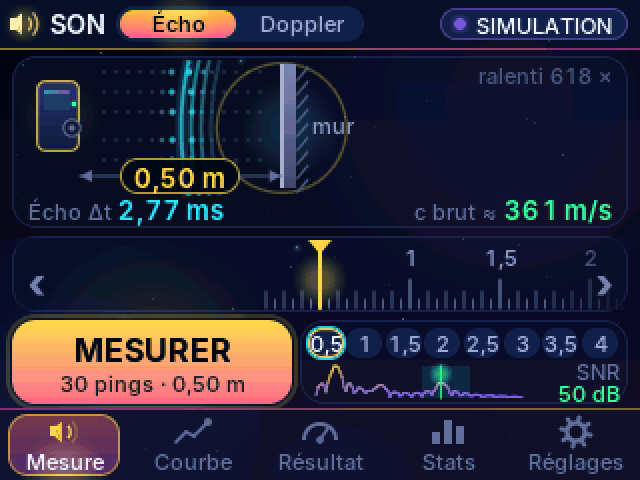 | 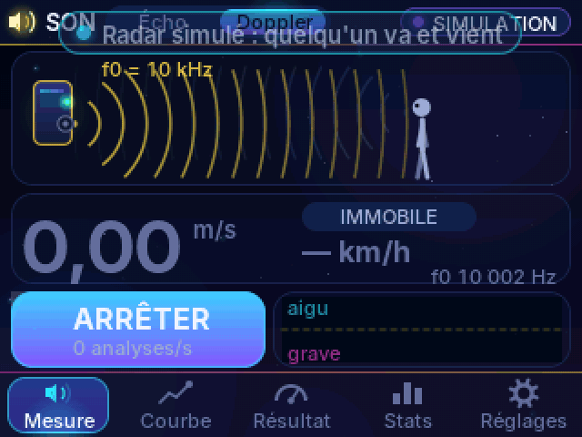 |

> 🎬 Vidéo de présentation commentée en français (6 min 23 s) : [**la vidéo (page Releases)**](https://github.com/Edunts5962/Esp32-vitesse-du-son/releases/latest), avec ses sous-titres .srt sur la même page. Chapitres et description YouTube : [`video_youtube.md`](video_youtube.md).
> 🎓 Protocole pour étudiants : [`protocole_etudiants.md`](protocole_etudiants.md)

---

## Sommaire

1. [Le principe](#1-le-principe)
2. [Le matériel](#2-le-matériel)
3. [Les fichiers du projet](#3-les-fichiers-du-projet)
4. [Installation](#4-installation)
5. [Les écrans et tous les réglages](#5-les-écrans-et-tous-les-réglages)
6. [Ce qui se passe pendant une mesure](#6-ce-qui-se-passe-pendant-une-mesure)
7. [Mode opératoire](#7-mode-opératoire)
8. [Exploiter les données sur PC](#8-exploiter-les-données-sur-pc)
9. [Simulateur PC et vidéo](#9-simulateur-pc-et-vidéo)
10. [Dépannage](#10-dépannage)
11. [Licence et crédits](#11-licence-et-crédits)

---

## 1. Le principe

### Le son, en chiffres

Dans l'air, le son parcourt **c = 331,3 × √(1 + T/273,15) m/s**, soit 343,2 m/s à 20 °C. C'est près d'un million de fois moins vite que la lumière. Pour traverser 1 m, il lui faut 2,9 ms.

### Un écho sur un mur

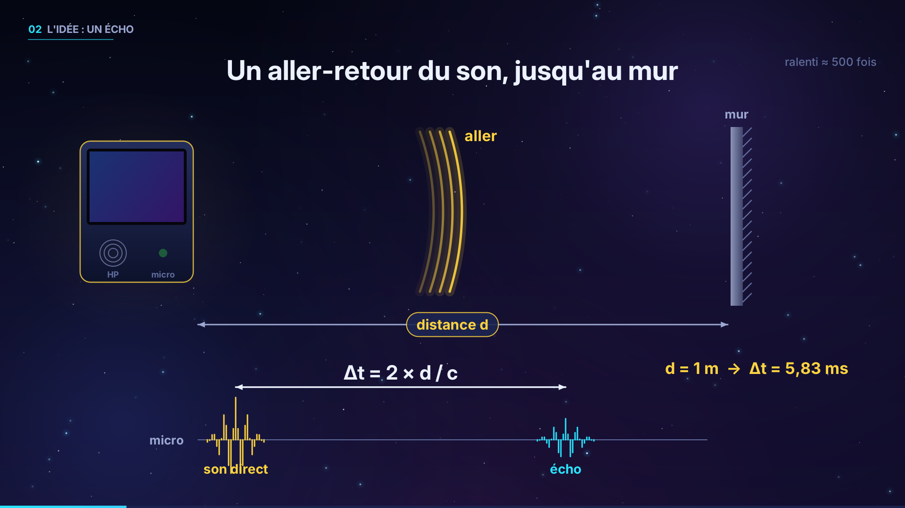

La carte, posée face à un mur à la distance d, émet un tic :

- le micro l'entend d'abord directement : c'est le **son direct** ;
- puis, après un aller-retour jusqu'au mur, il entend l'**écho**.

L'écart entre les deux vaut **Δt = 2d / c** (5,83 ms à 1 m).

Mesurer l'écart *direct → écho*, plutôt que le temps écoulé depuis l'émission, élimine le retard mal connu de la chaîne audio (mémoires tampons, codec). Le son direct traverse en effet exactement la même chaîne que l'écho.

### Le chronomètre : un glissando et un filtre adapté

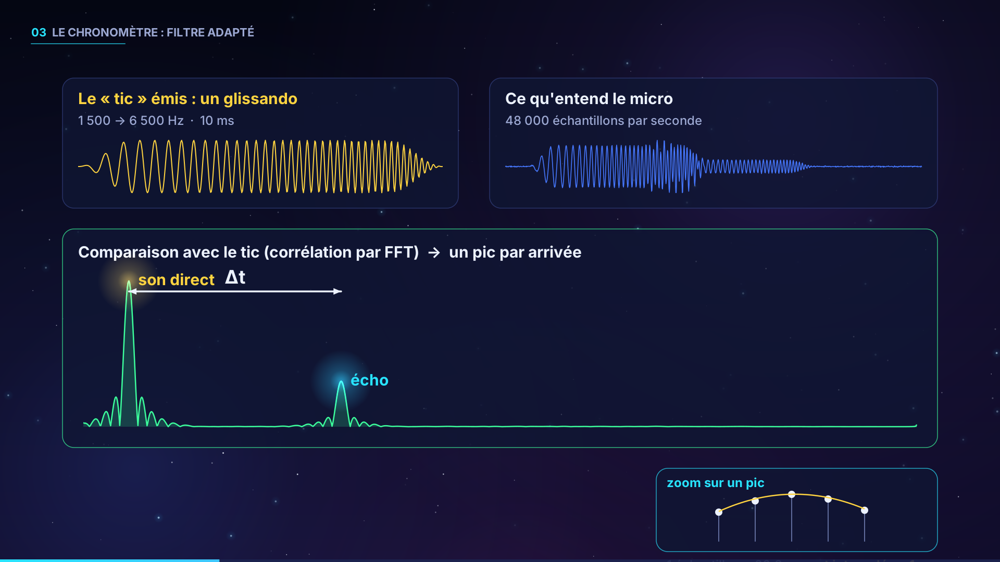

Le tic dure 10 ms. C'est un **glissando de 1 500 à 6 500 Hz**, appelé *chirp*. Le micro enregistre 48 000 échantillons par seconde. La carte calcule la **corrélation** de l'enregistrement avec le tic : c'est le *filtre adapté*, calculé par FFT de 8 192 points. Chaque arrivée du tic devient alors un pic d'environ 0,2 ms de large, bien au-dessus du bruit.

Un échantillon dure 20,8 µs, soit 3,6 mm de distance. Une **parabole** passée par le sommet de chaque pic le repère à environ **1 µs** près.

### Une mesure seule est bruitée…

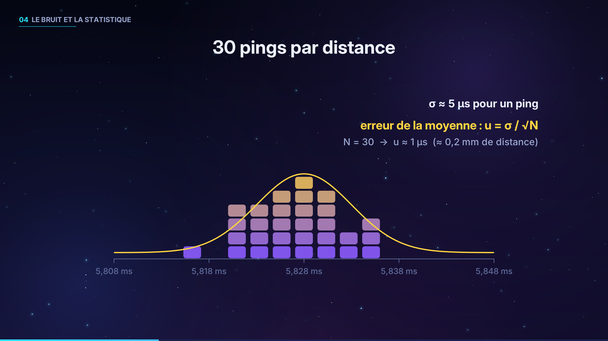

Chaque ping tombe un peu à côté, de l'ordre de σ ≈ 5 µs. La carte en fait 30 par distance (10, 30 ou 60 au choix). Elle écarte les valeurs aberrantes à plus de 3 écarts absolus médians de la médiane, puis fait la moyenne. L'incertitude de la moyenne vaut **u = σ/√N**.

### … mais une droite ne ment pas

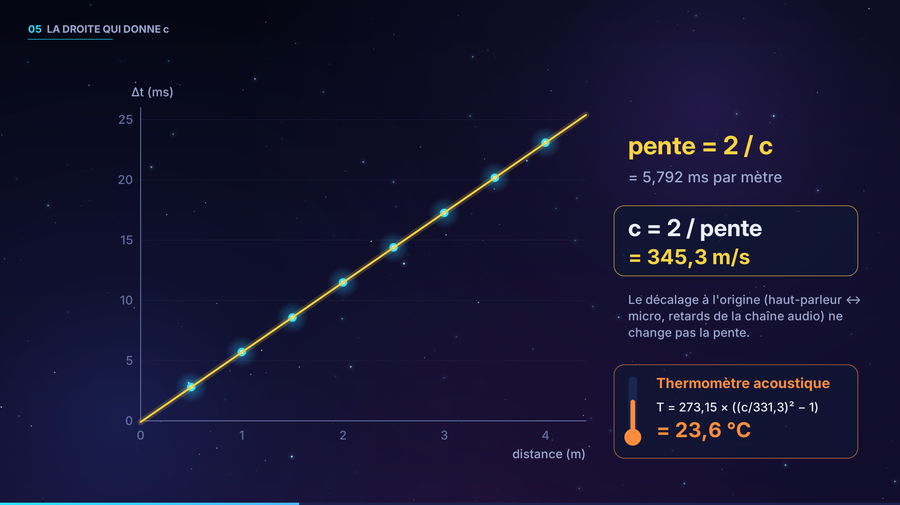

Les points (d, Δt) s'alignent sur une droite de **pente 2/c**, d'où **c = 2 / pente**. Le décalage à l'origine vient de l'écart haut-parleur ↔ micro et de l'endroit où l'on pose le mètre. Il ne change pas la pente. En bonus, **T = 273,15 × ((c/331,3)² − 1)** donne la température de l'air : c'est un *thermomètre acoustique*.

### L'effet Doppler

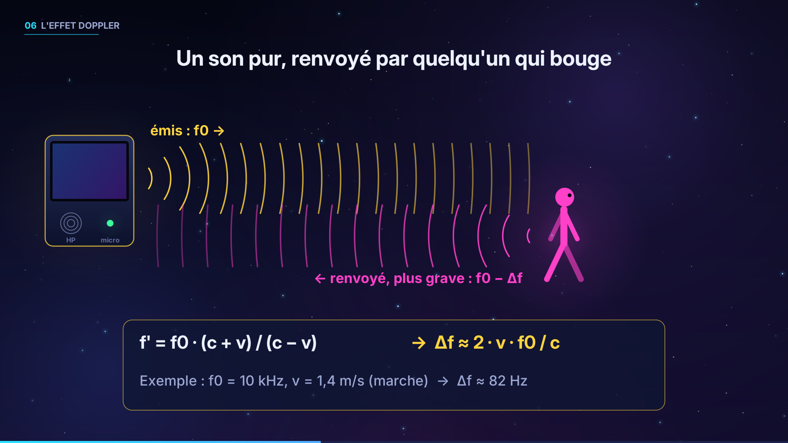

La carte émet un son pur f₀ (5, 10 ou 17 kHz). Une personne qui avance vers elle renvoie des ondes plus serrées, donc un son plus aigu. Si elle s'éloigne, les ondes sont étirées et le son revient plus grave :

> f' = f₀ (c + v)/(c − v) ⇒ **v = c · Δf / (2 f₀ + Δf)** ≈ c · Δf / (2 f₀)

À 10 kHz, une marche à 1,4 m/s décale le son de 82 Hz.

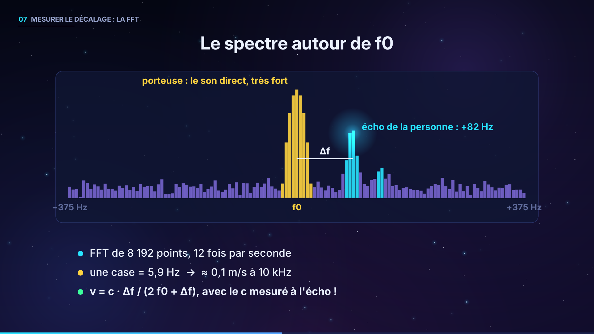

Pour séparer ce petit décalage de la porteuse directe, beaucoup plus forte, la carte calcule **12 spectres par seconde**. Chaque spectre est une FFT de 8 192 points, avec une fenêtre de Blackman-Harris. La fréquence émise tombe pile sur une case de la FFT : comme l'émission et l'enregistrement partagent la même horloge, la porteuse ne « fuit » pas dans les cases voisines. Une case fait 5,9 Hz, soit 0,1 m/s à 10 kHz. Le calcul utilise la valeur de **c mesurée** à l'écho si la droite est fiable (au moins 3 points, R² > 0,99). Sinon, il prend la valeur théorique.

| f₀ | λ | Résolution | Vitesse mini détectée | Vitesse maxi |
|---|---|---|---|---|
| 5 kHz | 6,9 cm | 0,20 m/s | ≈ 1,0 m/s | ≈ 12 m/s |
| 10 kHz | 3,4 cm | 0,10 m/s | ≈ 0,5 m/s | ≈ 6,4 m/s |
| 17 kHz | 2,0 cm | 0,06 m/s | ≈ 0,3 m/s | ≈ 3,8 m/s |

---

## 2. Le matériel

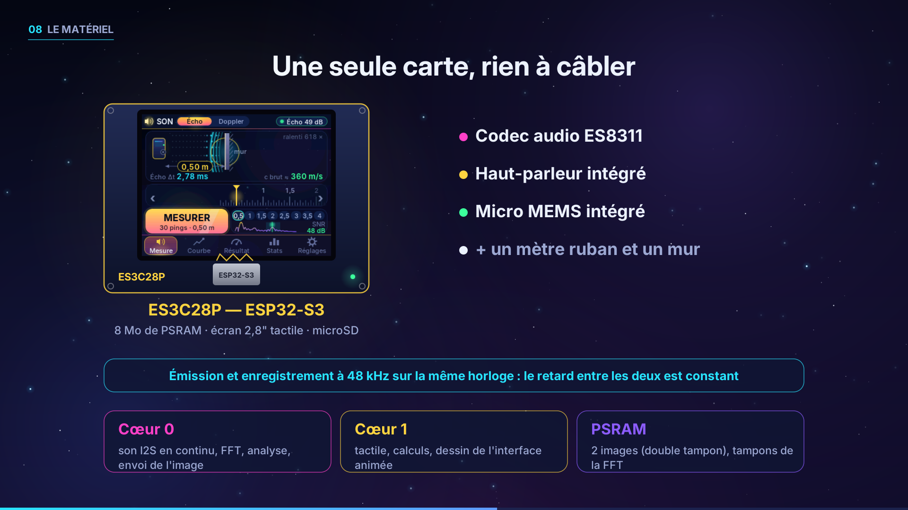

- **Une carte ES3C28P** :
  - puce ESP32-S3 avec 8 Mo de PSRAM et 16 Mo de flash ;
  - écran ILI9341 de 2,8" avec tactile FT6336 ;
  - lecteur microSD ;
  - **codec audio ES8311**, avec ampli, haut-parleur et micro MEMS intégrés.
- Un mètre ruban et un grand mur plat.
- Facultatif : une carte microSD, une batterie USB, un thermomètre.

Il n'y a **rien à câbler**. Voici le brochage utilisé, déjà sur la carte :

| Fonction | GPIO |
|---|---|
| I2S MCLK / BCLK / WS | 4 / 5 / 7 |
| I2S vers le codec (haut-parleur) / depuis le codec (micro) | 8 / 6 |
| Ampli du haut-parleur | 1 (niveau actif testé au démarrage) |
| I2C (tactile + codec à l'adresse 0x18) | SDA 16 / SCL 15 |
| Écran | SPI 10-13, DC 46, rétroéclairage 45 |
| microSD (SDIO 1 bit) | 38, 40, 39 |

**Répartition du travail dans la puce :**

- **cœur 0** :
  - tâche « audio » : I2S à 48 kHz en continu, qui écrit vers le haut-parleur et lit le micro **à chaque passage, sur la même horloge** ;
  - tâche « moteur » : FFT et analyse ;
  - envoi de l'image à l'écran.
- **cœur 1** : tactile, calculs des points et dessin de l'interface (double tampon en PSRAM).

---

## 3. Les fichiers du projet

```
firmware/son_console/
  son_console.ino   la carte : codec ES8311 (I2C), son I2S full-duplex, tâches, écran, tactile, SD
  dsp.cpp/.h        FFT, chirp, filtre adapté, analyse Doppler, sons simulés réalistes
  son.cpp/.h        points, droite, c, convergence, passages Doppler, statistiques, CSV
  moteur.cpp/.h     boucle de mesure : pings d'écho, analyse continue, scénario simulé
  interface.cpp/.h  les écrans animés, la règle tactile, les réglages
  gfx.cpp/.h        moteur de dessin lissé (repris de lumiere_console)
  polices.cpp/.h    police Inter avec accents (générée ; ajout de Δ, λ, ³, ½)
  ft6336_touch.*    pilote du tactile (inchangé)
  plateforme.h      ce que le cœur du programme demande au matériel
outils/
  simulateur/sim_main.cpp   le même code sur PC : scénario tactile, captures
  simulateur/sim_tuto.cpp   « tournage » des écrans de la vidéo (sons simulés)
  video/narration.py        voix off (Piper TTS)
  video/faire_video.py      la vidéo de présentation (pycairo + ffmpeg)
  analyser_csv.py           exploitation de son.csv
  generer_polices.py        générateur des polices
images/                     captures d'écran, schémas du principe, miniature YouTube
animations/                 GIF animés
protocole_etudiants.md      TP pour la classe
video_youtube.md            titre, description, chapitres, tags et texte de la voix off
```

Tout le code, sauf le `.ino`, est **identique sur la carte et sur le PC**. En mode simulation, le son est fabriqué : son direct, écho du mur, échos parasites (table, plafond, mur latéral), réverbération et bruit. Il est ensuite analysé par exactement le même code que le vrai son du micro.

---

## 4. Installation

### Logiciels

Arduino IDE 2.x avec le paquet **esp32 3.x** (testé en compilation avec 3.2.0), et la bibliothèque **TFT_eSPI**, configurée pour l'écran comme pour la console NES et `lumiere_console`.

### Carte : `firmware/son_console`

Ouvrir `son_console.ino`, puis régler :

| Réglage | Valeur |
|---|---|
| Carte | ESP32S3 Dev Module |
| PSRAM | OPI PSRAM |
| Flash Size | 16 MB |
| Partition Scheme | 16M Flash (3MB APP/9.9MB FATFS) |
| USB CDC On Boot | Enabled (pour le moniteur série) |

Le programme pèse 606 Ko, pour 76 Ko de RAM statique. L'**étalonnage du tactile** est partagé avec la console NES et `lumiere_console` : il n'est demandé qu'une fois.

Au démarrage, un **test audio** joue un tic et vérifie que le micro entend le son direct. Le résultat s'affiche :

- en bas de l'écran d'accueil ;
- dans Réglages › Appareil ;
- dans le moniteur série, à 115 200 bauds.

Exemples : « OK · direct 52 dB », « micro saturé », « micro ou HP muet », « codec ES8311 absent ». La documentation du fabricant et le BSP communautaire ne disent pas la même chose sur le niveau qui active l'ampli du haut-parleur (IO1). Le test essaie donc les deux niveaux.

---

## 5. Les écrans et tous les réglages

Le sélecteur **Écho / Doppler**, dans la barre du haut, choisit l'expérience. À droite, la pastille d'état indique « SIMULATION », « Micro prêt », « Écho 31 dB », « Radar actif » ou « Audio absent ».

### 5.1 Démarrage
Une animation se joue pendant le test audio, puis l'onglet Mesure s'affiche. On peut toucher l'écran pour passer l'animation.

### 5.2 Écho : onglet **Mesure**
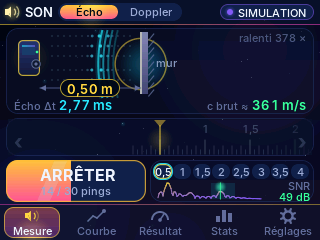
- **La scène** :
  - l'onde part du haut-parleur (en jaune) et revient du mur (en cyan) ;
  - des **molécules d'air** oscillent sur place, ce qui montre que l'onde est longitudinale ;
  - la cote affiche la distance ;
  - les lectures en direct donnent l'écho Δt et le **c ≈** correspondant. Ce c est « brut » tant que la droite n'existe pas ; ensuite, il est corrigé du décalage.
- **La règle** : on la fait glisser (avec de l'inertie), ou on utilise les flèches ‹ ›. Le pas est de 5 cm, de 0,2 à 15 m.
- **MESURER** lance la série de pings. Le bouton se remplit, et on peut l'arrêter en le touchant.
- **Les pastilles du plan** : un toucher règle la distance. Les distances faites sont en vert, la suivante clignote.
- **L'échogramme en direct** : le pic de l'écho et sa fenêtre de recherche, avec le SNR de l'écho.

### 5.3 Écho : onglet **Courbe**
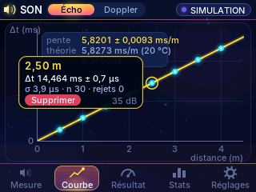
On y trouve :
- la droite Δt (ms) en fonction de la distance, avec sa bande de confiance à 95 % ;
- la droite théorique 2/c(T), en pointillés ;
- la pente, la théorie et R².

Toucher un point affiche Δt ± u, σ, n, les rejets et le SNR, avec un bouton **Supprimer**.

### 5.4 Écho : onglet **Résultat**
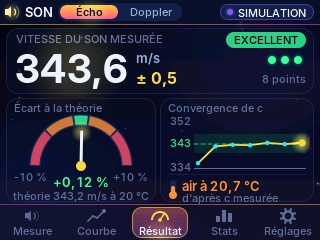
On y trouve :
- c ± incertitude, à partir de 3 points ;
- une note de EXCELLENT (< 1 %) à À AMÉLIORER ;
- une jauge de l'écart à c(T) ;
- la **convergence** de c au fil des points ;
- le **thermomètre acoustique** : la température de l'air déduite de c.

Une animation dévoile chaque nouvelle valeur.

### 5.5 Écho : onglet **Stats**
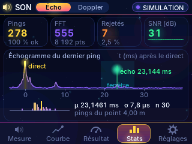
On y trouve :
- les compteurs : pings, FFT, rejets, SNR (avec une mini-courbe) ;
- l'**échogramme du dernier ping** : pic du son direct, fenêtre de recherche, écho et graduations en ms ;
- l'histogramme des Δt du point en cours, avec μ, σ et n.

### 5.6 Doppler : onglet **Mesure**
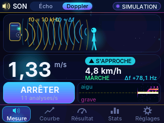
- **RADAR** lance le son continu.
- **La scène** montre :
  - les ondes émises (f₀, en jaune) ;
  - les ondes renvoyées : comprimées et bleues quand la personne approche, étirées et orange quand elle s'éloigne ;
  - un bonhomme animé qui avance ou recule.
- **Les lectures** : la grande vitesse (m/s), le sens (▲ S'APPROCHE / ▼ S'ÉLOIGNE), les km/h, l'allure (marche, jogging…) et Δf.
- **Le spectrogramme défilant** : la porteuse au centre, les sons plus aigus au-dessus, les plus graves en dessous.
- À la fin de chaque **passage**, une bulle donne sa vitesse maximale.

### 5.7 Doppler : onglets **Courbe**, **Résultat**, **Stats**
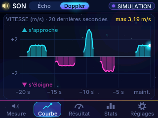
- **Courbe** : v(t) sur 20 s. L'approche est au-dessus de zéro, l'éloignement en dessous.
- **Résultat** : la vitesse maximale du dernier passage, sa moyenne, sa durée et la résolution ; l'échelle des allures ; les barres des 6 derniers passages.
- **Stats** : les compteurs ; le spectre en direct autour de f₀, avec la porteuse, le seuil de détection et Δf ; la formule v = c·Δf/(2f₀+Δf) calculée avec les vraies valeurs.

### 5.8 Onglet **Réglages**
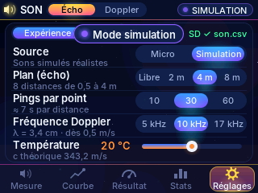

| Page | Réglage | Choix | Effet |
|---|---|---|---|
| Expérience | Source | Micro / Simulation | le vrai son, ou un son fabriqué réaliste |
| | Plan (écho) | Libre / 2 m / 4 m / 8 m | distances proposées (pastilles) |
| | Pings par point | 10 / 30 / 60 | ≈ 2 / 7 / 14 s par distance |
| | Fréquence Doppler | 5 / 10 / 17 kHz | λ, résolution, vitesse mini |
| | Température | 0 à 40 °C | valeur théorique c(T) |
| Appareil | Volume | Doux / Moyen / Fort | volume du haut-parleur (DAC −11,5 / −4,5 / 0 dB) |
| | Gain du micro | Bas / Moyen / Haut | +12 / +21 / +30 dB |
| | Luminosité | 5 à 100 % | rétroéclairage |
| | Effacer | 2 touchers | supprime les points et les passages |

Tous les réglages, et les points, sont mémorisés en mémoire non volatile (NVS).

### 5.9 Messages
| Message | Sens |
|---|---|
| ✓ 1,00 m mesuré · suivant 1,50 m | point ajouté, la règle passe à la distance suivante du plan |
| Mesure invalide : pas assez d'échos nets | moins d'un écho valide sur trois : rapprocher la carte, monter le volume, dégager la zone |
| Passage ▲ 1,41 m/s · 5,1 km/h | fin d'un passage Doppler |
| Audio indisponible | codec absent ou test raté (voir Dépannage) |

---

## 6. Ce qui se passe pendant une mesure

**Écho, pour chaque ping** (environ 4 par seconde pendant une série, 1,4 par seconde au repos) :

1. La tâche audio joue le tampon du tic (8 192 échantillons, chirp à 10 ms) et enregistre en même temps 8 192 échantillons du micro.
2. FFT de l'enregistrement, multiplication par le conjugué du spectre du chirp, signal analytique, puis FFT inverse : on obtient l'enveloppe de la corrélation.
3. Le son direct est le pic le plus fort. L'écho est le plus haut pic dans une **fenêtre** de ± 18 % autour du retard attendu 2d/c(T). Cette fenêtre élimine les échos de la table, du plafond et des murs latéraux.
4. Les sommets sont interpolés par une parabole. Δt = (écho − direct) / 48 000. Le ping est validé si le SNR de l'écho dépasse 10 dB et celui du son direct 20 dB.
5. Chaque ping valide est écrit sur la carte SD : `echo,d,Δt,SNR,source`.
6. Au bout de N pings, on calcule la médiane, on rejette les valeurs à plus de 3 MAD, on fait la moyenne, l'écart-type et u = σ/√n. Le point est ajouté (ou remplacé), puis la droite est recalculée par moindres carrés.

**Doppler, toutes les 85 ms :**

1. La fenêtre glissante de 8 192 échantillons avance de 4 096.
2. Fenêtre de Blackman-Harris, FFT, puis spectre en dB sur ± 64 cases autour de f₀.
3. Le plancher de bruit est la médiane, en dehors de la porteuse (± 4 cases). Le seuil est fixé 10 dB au-dessus.
4. On compare l'énergie au-dessus du seuil de chaque côté de f₀. Si un côté domine nettement, Δf est le **barycentre** de cette énergie, ce qui moyenne les bras et les jambes.
5. v = c·Δf/(2f₀+Δf), lissée par une médiane sur 3 valeurs.
6. Un **passage** est une suite d'au moins 4 détections, terminée par 0,5 s de calme. Il est enregistré avec sa vitesse maximale, sa moyenne, sa durée et son sens, et écrit sur la carte SD.

---

## 7. Mode opératoire

Le détail, avec les fiches de relevés et les questions, est dans [`protocole_etudiants.md`](protocole_etudiants.md).

**Écho**
1. Poser la carte face à un grand mur plat, haut-parleur vers le mur, à environ 1 m du sol, loin des murs latéraux.
2. Régler la température de la salle (Réglages › Expérience).
3. Pour chaque distance du plan, mesurer au mètre ruban de la grille du haut-parleur au mur. Régler la règle, appuyer sur **MESURER** et rester silencieux.
4. Lire c dans **Résultat**.

**Doppler**
1. Passer en **Doppler** et appuyer sur **RADAR**.
2. Marcher droit vers la carte depuis 4 à 5 m, puis repartir.
3. Comparer à un chronométrage sur 3 m.

---

## 8. Exploiter les données sur PC

Le fichier `son.csv`, sur la carte SD, contient une ligne par ping et une ligne par passage :

```
python3 outils/analyser_csv.py son.csv            # points, droite, c, température, passages
python3 outils/analyser_csv.py son.csv --graphe   # + graphique (matplotlib)
python3 outils/analyser_csv.py son.csv --source reel
```

---

## 9. Simulateur PC et vidéo

```bash
cd outils/simulateur
F=../../firmware/son_console
g++ -std=c++17 -O2 -I$F sim_main.cpp $F/{gfx,son,dsp,moteur,interface,polices}.cpp -o sim
./sim captures                      # captures .ppm + images des GIF

g++ -std=c++17 -O2 -I$F sim_tuto.cpp $F/{gfx,son,dsp,moteur,interface,polices}.cpp -o sim_tuto
./sim_tuto tournage                 # segments .rgb pour la vidéo

cd ../video
pip install pycairo numpy scipy piper-tts
# voix française : fr_FR-siwis-medium.onnx (+ .onnx.json), par exemple depuis
# https://github.com/k2-fsa/sherpa-onnx/releases/download/tts-models/vits-piper-fr_FR-siwis-medium.tar.bz2
python3 narration.py fr_FR-siwis-medium.onnx voix
for i in $(seq 0 13); do python3 faire_video.py ../simulateur/tournage sortie $i --voix voix; done
python3 faire_video.py ../simulateur/tournage sortie --assembler --voix voix
python3 faire_video.py ../simulateur/tournage sortie --final --voix voix      # MP4 + sous-titres .srt
python3 faire_video.py ../simulateur/tournage sortie --miniature --voix voix  # vignette YouTube
python3 faire_video.py ../simulateur/tournage sortie --images --voix voix     # schémas du README
```

---

## 10. Dépannage

| Symptôme | Piste |
|---|---|
| « codec ES8311 absent » | Vérifier que c'est bien une ES3C28P (la version avec audio). Le moniteur série affiche l'identifiant lu à l'adresse 0x18. |
| « micro ou HP muet » | Monter le volume (Appareil) et redémarrer. Le moniteur série indique le niveau du son direct pour chaque état de l'ampli. |
| « OK · micro saturé » | Baisser le **gain du micro**, ou le volume. |
| Écho absent, SNR < 10 dB | Mur trop loin ou absorbant (rideaux), carte mal orientée, obstacle. Rapprocher la carte ou monter le volume. |
| c trop grand à courte distance | Normal pour le « c brut » avant la droite : c'est le décalage haut-parleur/micro. Seule la pente compte. |
| Points mal alignés | Écho d'un mur latéral, d'une table ou d'une personne. Dégager et refaire le point (Courbe › Supprimer). |
| Doppler : rien ne bouge | Marcher plus vite ou plus près (dans l'axe). À 5 kHz, il faut dépasser ≈ 1 m/s : passer à 10 ou 17 kHz. |
| Le tactile est décalé | Effacer la NVS « touchcal » (ou réétalonner depuis la console NES). |

---

## 11. Licence et crédits

- Code : licence MIT (voir `LICENSE`).
- Police **Inter** © Rasmus Andersson, SIL Open Font License 1.1.
- Voix de la vidéo : **Piper**, voix fr_FR-siwis-medium (jeu de données SIWIS, CC-BY 4.0).
- Brochage audio relevé sur [lcdwiki](https://www.lcdwiki.com/2.8inch_ESP32-S3_Display) et dans le BSP communautaire [ngttai/esp32_s3_es3c28p](https://github.com/ngttai/esp32_s3_es3c28p). La séquence d'initialisation de l'ES8311 suit les pilotes d'Espressif.
- Les résultats montrés (captures, vidéo) viennent du **simulateur**, dont les sons sont fabriqués puis analysés par le même code que la carte. À vous de faire la vraie mesure !
